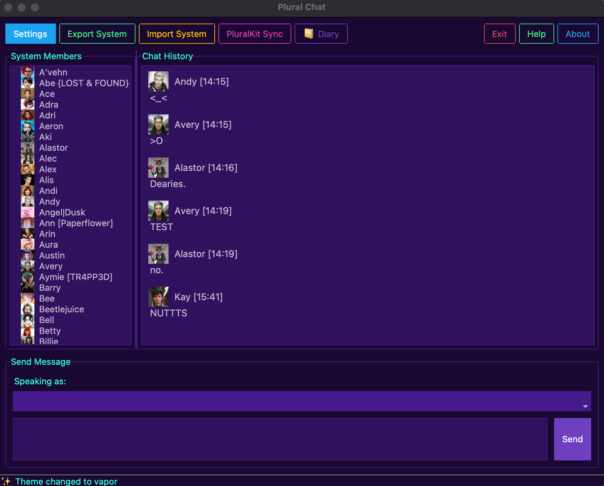
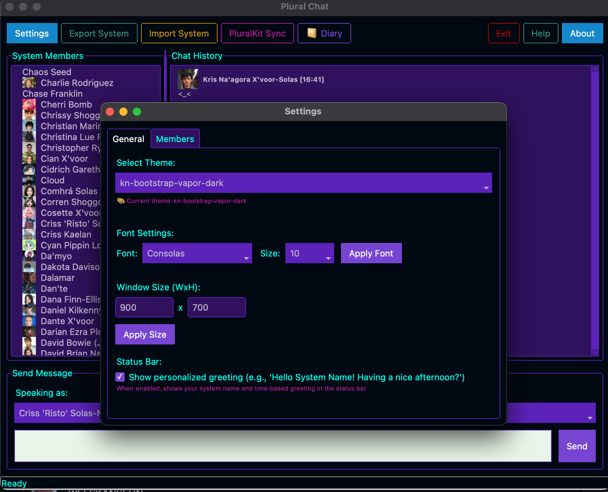
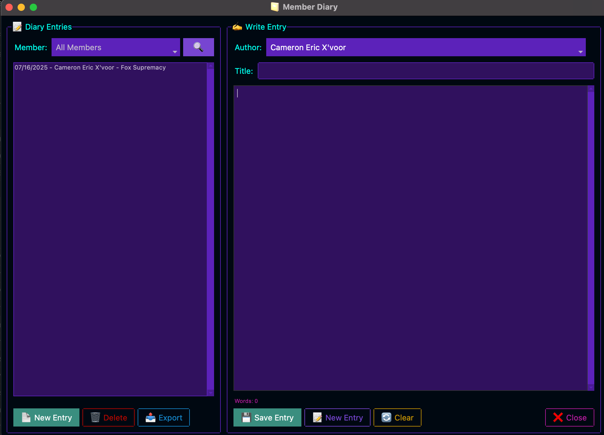
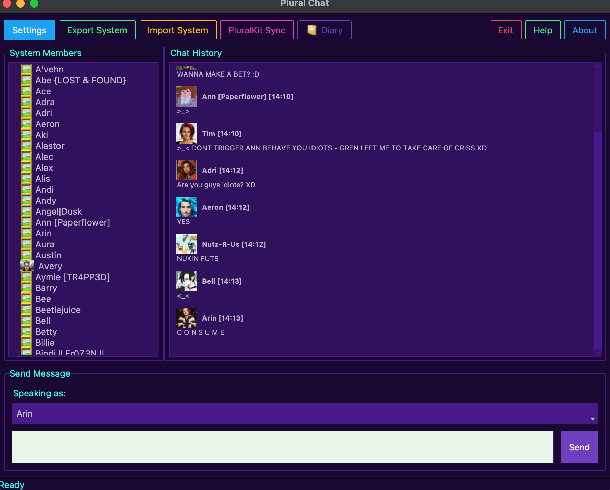
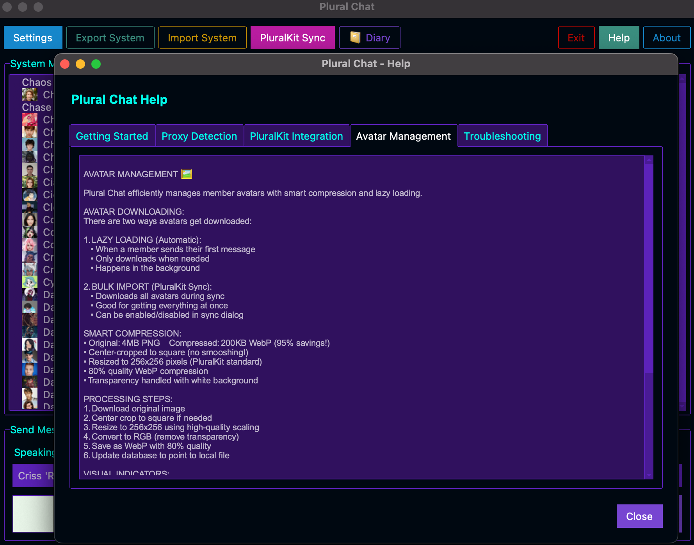

# 🗨️ Plural Chat

A desktop chat application designed specifically for plural systems, featuring PluralKit integration and intelligent proxy detection.

Notice: If you're looking for support and you're a plural system yourself please join our NON ML/AI server that's for plurals! 

https://discord.gg/QCkgPwf7ue

If you're NOT INTO AI and not plural feel free to go to our main E&D server for support here: https://discord.gg/5t2kYxt7An

## **NOTICE — WE'RE BACK (Oct 2026) 🚧**

Plural Chat is being REVIVED. Give us time — planning is in active progress, the old web edition was a security-and-scope mess (see below for why we shelved it) and we're rebuilding dialed-down and local-first.

**On AI, stated plainly:** We ARE using agentic AI tooling to help build this — MINIMAL assistance, for time and learning reasons (Dusk is the sole human on this and wants to learn to read and audit the code herself). **No AI / no LLM / no generative features will be implemented IN the final code.** The app will stay a clean, local-first tool for plural systems — nothing you say is shipped off to any model by the product itself.

**Developers — specifically full-stack folks who DON'T use AI:** you're welcome and extra welcome. This is open source; we can't pay — we pay in hugs, smiles, and eternal gratitude. 💜 Helping keep a kids-and-systems privacy bar high without burning Dusk out is where the value is.

*(The notice below is kept for honesty/historical reasons — it explains the shelving that this revival is fixing.)*

## **NOTICE (ARCHIVED — why we shelved it)**

Ktiseos Nyx is SHELVING/ARCHIVING pluralchat for SECURITY REASONS. Not personal reasons. 
The amount of security required to keep systems and those requiring this sort of app is INTENSE, and with the amount of rogue LLM's and agentic tools out there, we don't need to be responsible for data theft or otherwise.  The Python version is "CUTE" and "NEAT" but at the moment: it does not service enough security to function safely.  

ENV files are "SECURE" but they're about as secure as 2018 encryption for something that has to do with connecting to other services.  If this were an AI focused app, we would NOT hesitate to keep going - because security moves differently in AI circles.  Pluralchat's next/react version has barely any security to it, and runs off the smell of localhost er an oily rag.  

We FULLY appreciate that people have picked this up, and we understand that we've stated about RETIRING from genAI before, but that's a totally other subject and you'll have to connect via discord for that.

As for support: WE WILL still take support requests for the app even after archiving, but only for the archived edition - not for anyone's forks.  Archival enables someone else in the community to fork, and continue the development.

Please note that we DO NOT have servers for this, so if you have tried to use our next/react version on a server and found a "UNSECURE DOMAIN" of sorts? We are not affiliated with MaplePet. In fact this is the OTHER reason why we're archiving: Anyone and everyone in open source can fork, serve and host these tools. But since wer'e the original developer of this particular edition: We're responsible for code.

If you host without forking: We do not have a lot of support, the next/react edition is not secure and never finished. 

If you use the python edition without forking: we DO offer minimal support. 

PLEASE DO FORK = you're even welcome to COPY OVER THE CODE and redevelop, this is esentially like Twinote + SimplyPlural and a bunch of stuff inbetween. We're just not as focused on plural ONLY content due to the immense security required for data integrity for mental health and plural systems. 

If this was just for RP or otherwise we'd not worry AS much. 

## 📑 Table of Contents

- [✨ Features](#-features)
- [📸 Screenshots](#-screenshots)
- [⚠️ Known Issues](#️-known-issues)
- [📋 Project Documentation](#-project-documentation)
- [🚀 Quick Start](#-quick-start)
  - [Prerequisites](#prerequisites)
  - [Installation](#installation)
  - [First Time Setup](#first-time-setup)
- [🎯 Proxy Detection](#-proxy-detection)
- [🔧 PluralKit Integration](#-pluralkit-integration)
  - [API Token Setup](#api-token-setup)
  - [What Gets Imported](#what-gets-imported)
- [📁 File Structure](#-file-structure)
- [🎨 Themes](#-themes)
- [📤 Sharing Systems](#-sharing-systems)
- [🛠️ Development](#️-development)
  - [Tech Stack](#tech-stack)
  - [Project Structure](#project-structure)
- [🤝 Contributing](#-contributing)
- [📄 License](#-license)
- [💝 Credits](#-credits)
- [🔗 Links](#-links)

## ✨ Features

- **🏠 Local Desktop Chat** - Private conversations between system members
- **🔗 PluralKit Integration** - Import members, avatars, and proxy tags from your PK system
- **🎯 Smart Proxy Detection** - Automatic member switching based on proxy patterns
- **💾 SQLite Database** - Fast, reliable local storage
- **🎨 Modern Themes** - 15+ beautiful themes via ttkbootstrap
- **📤 Export/Import** - Share system configurations with other plural folks
- **🖼️ Avatar Support** - Display member avatars in chat
- **📔 Personal Diary** - Private journal system for individual members
- **⚙️ Advanced Settings** - Configurable cache sizes to optimize performance based on system resources
- **🛡️ Enhanced Security** - Improved URL validation and secure file handling
- **🔄 Improved Stability** - Better error handling and retry mechanisms for network operations
- **📱 Cross-Platform Support** - Optimized for macOS, Windows, and Linux including better UI responsiveness

## 📸 Screenshots

| Main Chat Interface | Settings & Custom Themes | Personal Diary System |
| :-----------------: | :----------------------: | :-------------------: |
|  |  |  |
| **Active Conversations** | **Help Documentation** | **Theme Showcase** |
|  |  |  |

## ⚠️ Known Issues

- **Private Members**: Private members cannot have their avatars downloaded via API (this is expected behavior for privacy protection)
- **Sample Members**: Sample members are not added upon developer cleanup (manual setup required for fresh installations)

## 📋 Project Documentation

- **[Installation Guide](INSTALLATION.md)** - Detailed installation instructions for all platforms
- **[Contributing Guide](CONTRIBUTING.md)** - How to contribute to the project
- **[Code of Conduct](CODE_OF_CONDUCT.md)** - Community guidelines and standards
- **[Security Policy](SECURITY.md)** - Security practices and vulnerability reporting
- **[Development Roadmap](DEVELOPMENT_ROADMAP.md)** - Future features and development plans
- **[Community Disclaimer](DISCLAIMER.md)** - Our inclusive ethos and stance on plural community drama
- **[Third-Party Notices](NOTICES.md)** - Licensing and attribution information

## 🚀 Quick Start

### Prerequisites

- Python 3.8 or higher
- pip (Python package installer)

### Installation

1.  **Clone the Repository**
    ```bash
    git clone https://github.com/Ktiseos-Nyx/plural_chat.git
    cd plural_chat
    ```

2.  **Install the Application**
    ```bash
    pip install .
    ```
    > **Note:** For development, use `pip install -e .` to install in "editable" mode.

3.  **Run the Application**
    ```bash
    plural-chat
    ```

### 🐧 A Note for Linux Users (`externally-managed-environment`)

Some newer Linux distributions (like Ubuntu 23.04+, Debian 12+, and their derivatives) protect their system Python installation. If you see an `error: externally-managed-environment` when running `pip install`, you **must** use a virtual environment. This is the standard best practice for Python development on all operating systems.

**1. Create and Activate a Virtual Environment**
Before the installation step, create an isolated environment:
```bash
# Inside the plural_chat directory
python3 -m venv .venv

# Activate it (you must do this every time you open a new terminal)
source .venv/bin/activate
```

**2. Install and Run**
Now that your prompt shows `(.venv)`, you can proceed with the installation and running the app as described above:
```bash
pip install .
plural-chat
```
When you are finished, you can leave the environment by typing `deactivate`.

### First Time Setup

1. **Add Members** - Use the Settings → Members tab to add your system members
2. **Set Avatars** - Add avatar images for visual identification
3. **PluralKit Sync** (Optional) - Import your existing PK system data via PK's API or via Json export via pk;export on Discord.
4. **Choose Theme** - Pick from 15+ modern themes in Settings

## 🎯 Proxy Detection

If you've imported from PluralKit or set up proxy tags, the app will automatically detect them:

- Type `member: hello there` → Auto-selects "member" and sends "hello there"
- Visual feedback shows when proxy is detected
- Clean messages without proxy tags in chat history

### Future Foward Issue
Not everyone uses member: proxy - so being that this was developed in less than 12 hours, it'd be amazing if anyone would want to help out in robustish level fix this!

## 🔧 PluralKit Integration

### API Token Setup

1. Get your PK token from [PluralKit Dashboard](https://dash.pluralkit.me/dash/token)
2. Click "PluralKit Sync" in the app
3. Enter your token and test connection
4. Choose "Sync Members" or "Full Import"

### What Gets Imported

- ✅ Member names and display names
- ✅ Pronouns and descriptions  
- ✅ Proxy tags for auto-detection
- ✅ Avatar images (downloaded locally)
- ✅ Member colors and metadata
- ✅ Chat history (if present in export)

## 📁 File Structure

- `app.db` - Application settings and preferences
- `system.db` - Your system's members and chat history  
- `avatars/` - Downloaded avatar images
- `*.json` - Export files for sharing

## 🎨 Themes

Choose from these beautiful themes:
- superhero, darkly, solar, cyborg, vapor
- pulse, flatly, journal, litera, lumen
- minty, morph, sandstone, united, yeti

## 📤 Sharing Systems

**Export your system:**
- Click "Export System" → Save as JSON
- Share file with other plural folks
- Includes members, chat history, and settings

**Import a system:**
- Click "Import System" → Select JSON file
- Supports PluralKit exports (auto-detects and converts)
- Our export format is compatible for re-importing

## 🛠️ Development

### Tech Stack

- **Python 3.8+** - Core language
- **ttkbootstrap** - Modern UI framework
- **SQLite** - Local database
- **Pillow** - Image processing
- **Requests** - HTTP client for PluralKit API
- **aiohttp** - Asynchronous HTTP client
- **aria2p** - High-performance download manager
- **platformdirs** - Cross-platform directory management

### Project Structure

```
plural_chat/
├── main.py                 # Main application
├── database_manager.py     # SQLite database handling
├── pluralkit_api.py       # PK API integration
├── pluralkit_dialog.py    # PK sync UI
├── pk_export_parser.py    # PK export file parser
├── member_manager.py      # Member management UI
├── settings_manager.py    # Settings UI
├── about_dialog.py        # About dialog
├── requirements.txt       # Python dependencies
├── pyproject.toml        # Project configuration
└── LICENSE               # MIT license
```

## 🤝 Contributing

We welcome contributions from the plural community! Whether it's:

- 🐛 Bug reports
- 💡 Feature suggestions  
- 🔧 Code improvements
- 📖 Documentation updates

**Please read our [Contributing Guide](CONTRIBUTING.md) and [Code of Conduct](CODE_OF_CONDUCT.md) before getting started.**

**Want to see what's coming next?** Check out our [Development Roadmap](DEVELOPMENT_ROADMAP.md) to see planned features and find areas where you can help!

## 📄 License

This project is licensed under the MIT License - see the [LICENSE](LICENSE) file for details.

For third-party components and attributions, see [NOTICES.md](NOTICES.md).

## 💝 Credits

- **Created by:** Duskfall Portal Crew
- **Inspired by:** The amazing plural community
- **Thanks to:** PluralKit team for the fantastic API
- **UI Framework:** ttkbootstrap developers

## 🔗 Links

- **[GitHub Issues](https://github.com/Ktiseos-Nyx/plural_chat/issues)** - Bug reports and feature requests
- **[GitHub Discussions](https://github.com/Ktiseos-Nyx/plural_chat/discussions)** - Community discussions and Q&A
- **[PluralKit](https://pluralkit.me)** - The bot that inspired this project
- **[ttkbootstrap](https://ttkbootstrap.readthedocs.io)** - Modern tkinter themes
- **[Support us](https://ko-fi.com/duskfallcrew)** - Help keep development going
- **[Ktiseos Nyx Discord](https://discord.gg/HhBSvM9gBY)** - Development & AI Discord (Plural Friendly!/PK Enabled)
- **[Earth & Dusk Media Discord](https://discord.gg/5t2kYxt7An)** - Our Twitch & Media Discord (PK enabled!) **IF YOU ARE NOT INTO AI PLEASE JOIN HERE**

---

*Made with 💜 by and for the plural community*
